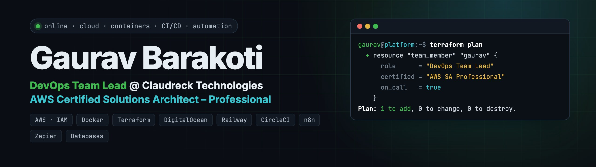
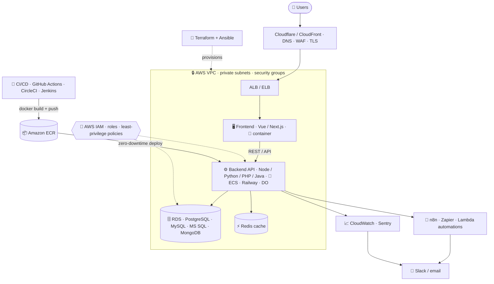
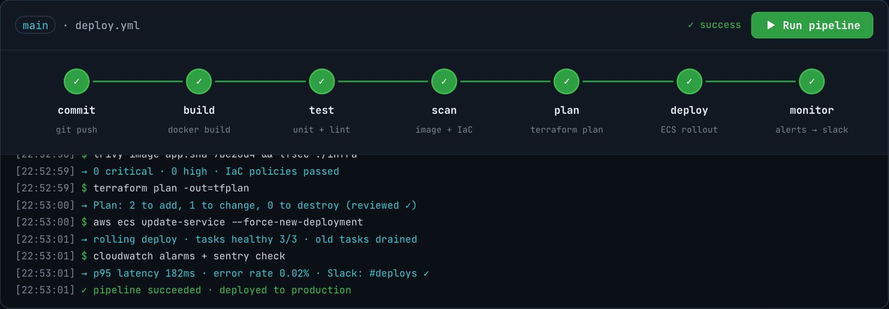

<a href="https://gauravbarakoti.github.io/platform-engineering-portfolio/">
  
</a>

<div align="center">

### 👋 Hi, I'm Gaurav: DevOps Team Lead who wires frontends, backends, databases and clouds into platforms that ship fast and stay up.

[](https://gauravbarakoti.github.io/platform-engineering-portfolio/)
[](https://www.linkedin.com/in/gauravbarakoti)
[](mailto:bestgaurav1234@gmail.com)

</div>

```bash
gaurav@platform:~$ whoami
DevOps Team Lead @ Claudreck Technologies · AWS Certified Solutions Architect – Professional

gaurav@platform:~$ cat focus.yaml
cloud:        [AWS, GCP, DigitalOcean, Railway, Heroku]
containers:   [Docker, Docker Compose, Amazon ECS/ECR]
iac:          [Terraform (modules), Ansible]
ci_cd:        [GitHub Actions, CircleCI, Jenkins, AWS CodePipeline/CodeDeploy]
automation:   [n8n, Zapier, AWS Lambda, Python boto3]
data:         [Amazon RDS, PostgreSQL, MySQL, MS SQL, Redis, MongoDB]
connectivity: [AWS IAM, VPC, Security Groups, ALB/ELB, CloudFront, Cloudflare, DNS]
observe:      [CloudWatch, Sentry, Elasticsearch, Slack alerts]
```

---

### 🏗️ How I wire a production app, end to end



---

### 🛠️ Toolbox

**Cloud & PaaS**<br/>


**Containers & IaC**<br/>


**CI/CD**<br/>


**Automation**<br/>


**Databases**<br/>


**Connectivity & Security**<br/>


**Observability & OS**<br/>


---

### 🚀 Client work

| | | |
|---|---|---|
| 🟣 **[Optum](https://www.optum.com) · Dojo360** · 2024 – Present | Terraform development & **reusable Terraform modules** for the Dojo360 module | `Terraform` `IaC` |
| 🟢 **[Dashboard Lim](https://dashboard-lim.com)** · 2024 – Present | DevOps & cloud infrastructure for dashboards, API automations & AI tools | `Cloud` `Automation` |
| ✅ **[NewLIST](http://www.newlist.com)** · 2024 – 2025 | Test/stage/prod operations, Amazon Inspector remediation, CloudWatch everywhere | `Beanstalk` `CodePipeline` `WAF` `CloudFront` `RDS` |
| 🔵 **DigitalOcean → AWS** · 2026 | Led a production migration, scaling and memory-leak fixes at Shipway | `AWS` `DigitalOcean` `SRE` |
| 🟢 **Westminiter** | ECR → ECS with lazy loading for a 4 GB image; Terraform for EC2, IAM, S3, SQS, Bedrock, RDS | `Terraform` `Docker` `ECS` |

### 🧪 Hands-on labs (open source)

| Repo | What it shows |
|---|---|
| 🏛️ [**3TIER_ARCHITECTURE**](https://github.com/GauravBarakoti/3TIER_ARCHITECTURE) | Modular **Terraform** 3-tier AWS architecture: **VPC**, load balancer, Auto Scaling EC2, bastion host, **RDS** and S3 (web → app → database connectivity) |
| 🐳 [**vue.js-applicaition-dockerise**](https://github.com/GauravBarakoti/vue.js-applicaition-dockerise) | Dockerised Vue.js app → **ECR → ECS** behind **ELB / ALB** |
| 🔁 [**circleci-poc**](https://github.com/GauravBarakoti/circleci-poc) | **CircleCI** pipeline deploying an app with **zero downtime** |
| 🗄️ [**app-deployment-on-WindowsServer-using-Jenkins**](https://github.com/GauravBarakoti/app-deployment-on-WindowsServer-using-Jenkins) | Jenkins deploy of a .NET login app on Windows Server with an **RDS MS SQL** database |
| 🧱 [**aws-component-terraform**](https://github.com/GauravBarakoti/aws-component-terraform) | AWS resources provisioned with **Terraform** |
| 🚚 [**codeDeploy-AWS-python**](https://github.com/GauravBarakoti/codeDeploy-AWS-python) | Python app shipped with **AWS CodeDeploy** |
| ⚙️ [**ansibleWithJenkins**](https://github.com/GauravBarakoti/ansibleWithJenkins) | **Ansible** automation triggered from **Jenkins** |
| 🐍 [**boto-scripts**](https://github.com/GauravBarakoti/boto-scripts) · [**AWS-python-scripts**](https://github.com/GauravBarakoti/AWS-python-scripts) | **boto3** automation and audits across AWS services |
| 📊 [**cloudwatch-queries-for-dashboard**](https://github.com/GauravBarakoti/cloudwatch-queries-for-dashboard) | CloudWatch Logs Insights queries and dashboard widgets |

<a href="https://gauravbarakoti.github.io/platform-engineering-portfolio/#pipeline"></a>

### 🏅 Certifications


---

<div align="center">

`$ terraform plan` → **Plan: 1 to add** (a DevOps lead for your platform), 0 to change, 0 to destroy.

[Portfolio](https://gauravbarakoti.github.io/platform-engineering-portfolio/) · [LinkedIn](https://www.linkedin.com/in/gauravbarakoti) · [bestgaurav1234@gmail.com](mailto:bestgaurav1234@gmail.com)

</div>
